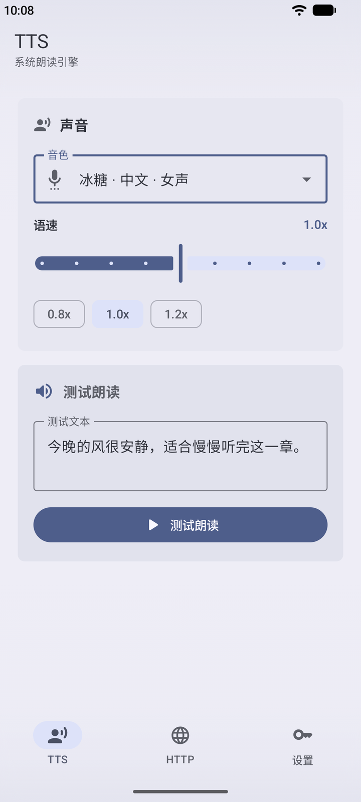
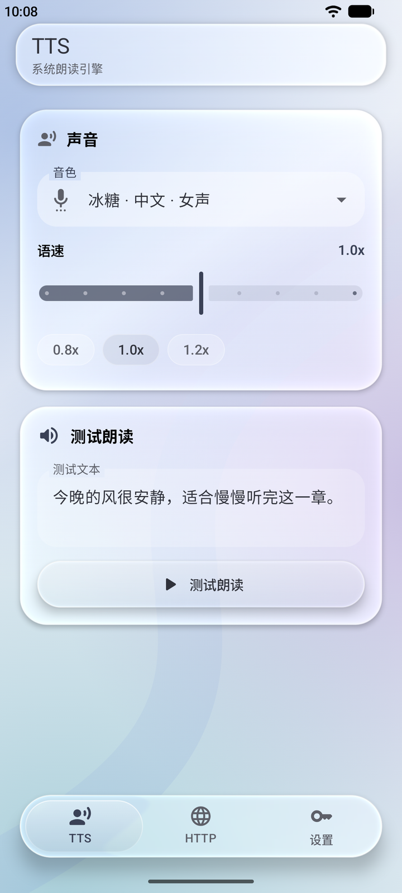
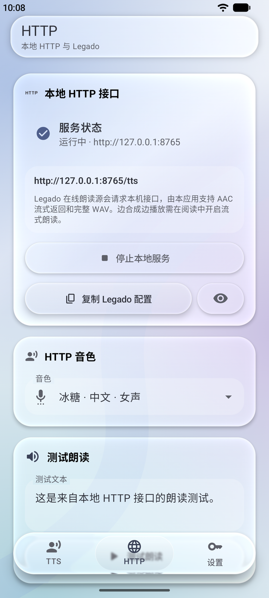
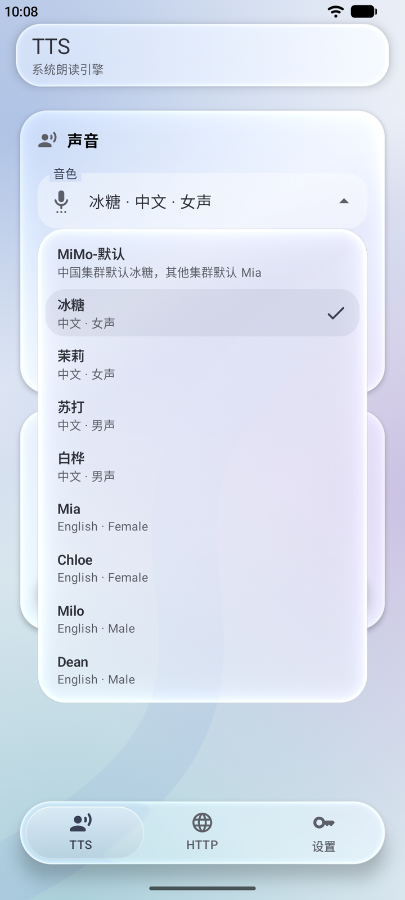

# Mimo TTS Engine

[English](README.en.md) · [下载 APK](https://github.com/linvva/mimo-tts-engine/releases) · [开发文档](docs/development.md)

让 Android 和阅读软件使用小米 MiMo 朗读。既可作为系统文字转语音引擎，也可为 Legado / 阅读提供本地 HTTP 朗读服务，支持流式播放和多角色音色。

需要 Android 11 或更高版本，以及你自己的 MiMo API Key。

## 界面预览

经典与液态玻璃两种风格可随时切换。玻璃模式提供悬浮底栏、透明卡片及配套控件；两种风格共用设置、当前页面与输入状态。

<table>
  <tr>
    <th>经典 · TTS</th>
    <th>液态玻璃 · TTS</th>
  </tr>
  <tr>
    <td></td>
    <td></td>
  </tr>
  <tr>
    <th>本地 HTTP 服务</th>
    <th>音色选择</th>
  </tr>
  <tr>
    <td></td>
    <td></td>
  </tr>
</table>

截图来自当前源码的 Debug 构建，使用演示配置。已发布版本以 [GitHub Releases](https://github.com/linvva/mimo-tts-engine/releases) 为准。

## 功能

- **系统 TTS**：注册为 Android 文字转语音引擎，兼容调用系统 TTS 的应用，使用流式 PCM16 输出。
- **本地 HTTP**：为阅读软件提供流式 AAC 或完整 WAV，仅监听本机 `127.0.0.1:8765`。
- **纯符号静音**：整段省略号等符号可在本地静音，支持开关和 0～10000 毫秒停顿，不请求 MiMo。
- **多角色朗读**：导出完整音色目录，在阅读中为不同角色指定音色。
- **流式与预合成**：两路上游合成并发，同参数流式请求共享合成结果和短时缓存。
- **双风格界面**：经典 / 液态玻璃即时切换，记住风格与上次打开的标签页。
- **快捷启停**：通过快捷设置磁贴启停 HTTP 服务，长按进入 App；前台通知与后台保活设置辅助锁屏朗读。

## 快速上手

### 安装与配置

1. 从 [GitHub Releases](https://github.com/linvva/mimo-tts-engine/releases) 下载并安装 APK。
2. 打开 App，在「设置」中填入 MiMo API Key。
3. 在「TTS」页选择音色、语速，并点击「测试朗读」。
4. 可在「设置 → 朗读风格」中调整提示词，在「外观 → 界面风格」中切换界面。

API Key、音色、语速与提示词保存在本机 DataStore 中。更换界面风格不会修改朗读配置。

### 用作系统 TTS

1. 打开 Android 系统设置中的「文字转语音输出」。常见路径为「无障碍 → 文字转语音输出」或「常规管理 → 文字转语音输出」。
2. 将 `Mimo TTS Engine` 选为首选引擎。
3. 在阅读软件中选择系统 TTS 朗读。

### 接入 Legado / 阅读

1. 打开 App 的「HTTP」页，启动本地服务。
2. 点击「复制 Legado 配置」，在阅读的在线朗读源中导入。
3. 在阅读中开启「流式朗读」，即可使用默认的 AAC 流式配置。
4. 按需为不同角色重新选择音色。需要完整音频时，可在配置面板选择「复制 WAV 兼容配置」。

首次升级到 **0.2.0** 时，请用新导出的配置替换旧源，并重新选择角色音色，避免继续使用旧源及旧的慢速缓存。

HTTP 语速按阅读传入的 `speakSpeed / 10` 表达，例如 `10 → 1×`、`15 → 1.5×`、`20 → 2×`，不叠加 App 内的系统 TTS 语速。MiMo 提示词调速是近似效果，阅读全局倍速由播放器控制。

AAC 为 24 kHz、单声道、64 kbps 的有损编码。生成中时长可能未知，尚未缓存位置的精确拖动不作保证；WAV 适合需要完整音频的兼容场景。接口参数、缓存、超时及自动检查见 [HTTP 适配说明](docs/http-tts.md)。

### 后台与锁屏

在「设置 → 后台保活」中检查通知权限、电池优化与应用后台限制。部分 MIUI / OEM 系统还需要手动允许后台运行，或将省电策略设为无限制。

系统 TTS 合成与 HTTP 服务运行时会显示前台通知。可以在快捷设置中添加 `Mimo HTTP` 磁贴，用于启停服务。

## 开发

当前源码目标版本为 `0.2.1`（`versionCode=8`）。使用 Android Studio 打开仓库根目录，完成 Gradle Sync 后运行。

```bash
./gradlew :app:assembleDebug
```

Debug 使用独立包名与默认 Debug 签名，可与 Release 并排安装；两版分别保存设置，但均使用端口 `8765`，HTTP 服务需交替运行。

- [开发环境、签名与发布](docs/development.md)
- [界面风格](docs/ui-styles.md)
- [HTTP 接口与阅读适配](docs/http-tts.md)

## 许可证

[GNU GPL v3](LICENSE)
